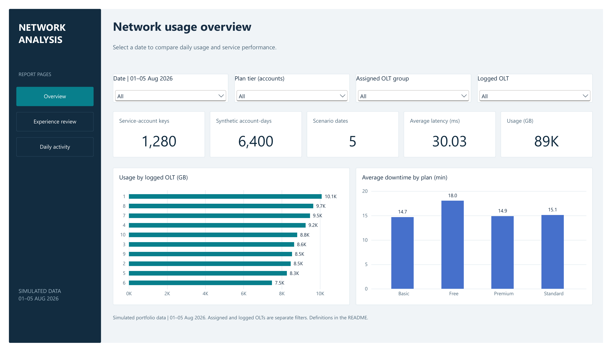
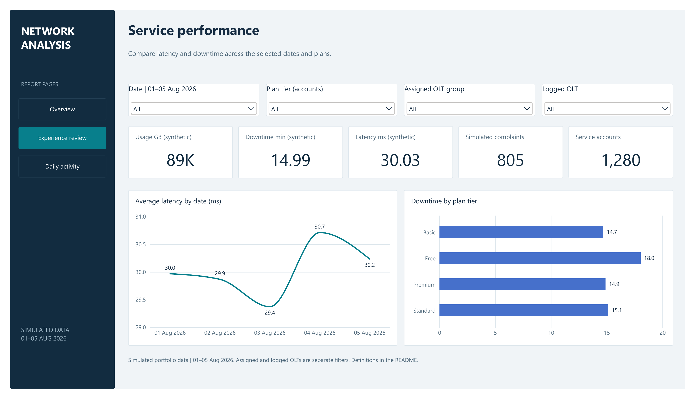
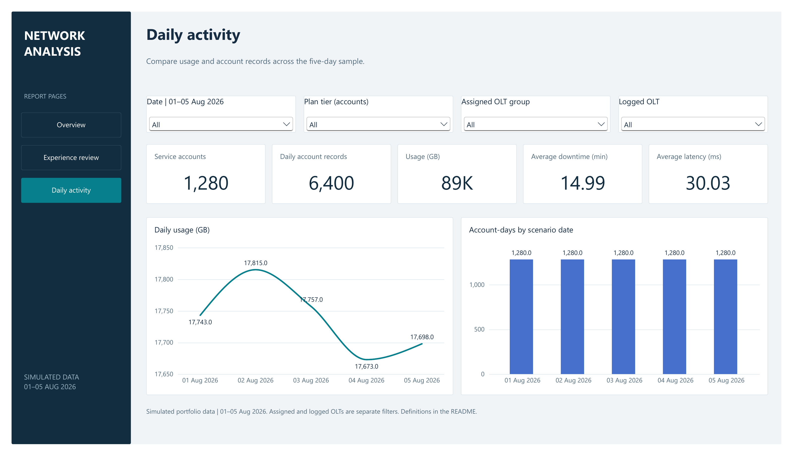

# Network Service Experience & Data Readiness

A Python, SQL and Power BI project that explores broadband usage and service experience while testing whether the available data can support churn-risk calculations. The five-day usage sample is simulated; the strongest result is identifying where a metric must remain unavailable.

## Dashboard preview

Three actual pages from the local `Network_Completed.pbix`, last saved on 16 October 2026 and exported through Power BI Desktop on 24 November. Images are 3,200 pixels wide with all four filters set to All.

### Network usage overview



### Service performance



### Daily activity



## Analytical questions and implemented work

- Profile daily usage, latency, downtime and complaints at account-day grain.
- Convert decimal GB per day to average Gbps before comparing with assumed capacity.
- Keep assigned OLT groups separate from logged usage OLT IDs instead of forcing incompatible joins.
- Calculate complaints only as of each observation date to avoid future-event leakage.
- Require two complete, disjoint seven-day windows and positive prior usage before calculating the full rule-based risk score.
- Reconcile pandas, SQL and Power BI measures with tests for missing days, duplicate keys, zero denominators and report-input consistency.

## Results that can be defended

| Result | Interpretation |
|---|---|
| 1,280 service-account keys and 6,400 account-days | Five dates, 1–5 August 2026; account keys are row labels. |
| Zero complete 14-day windows | Full risk scores and high-risk share remain blank, not zero. Five days cannot validate a churn predictor. |
| 1,135 assigned/logged ID conflicts (88.67%) | Compatibility between source-derived groups and a separately generated simulation, not evidence of faulty provisioning. |
| Ten simulated OLT IDs versus 12 source groups | Different entity scopes; overlapping numeric labels do not prove identity. |
| 9.83% mean daily-average capacity ratio; 17.98% maximum | Ratios against assumed capacity, not measured peak congestion. |
| 805 simulated complaints | Separately generated events using seed 42. |

The report shows 30.03 ms average latency, 14.99 minutes average downtime and rounded usage of 89K GB. The threshold-based experience score averages 89.07. Source reconciliation also found 71 simulated account-days before original activation across 15 keys; this is a chronology mismatch, not real pre-activation traffic.

## Data and methodology

Usage, speed, downtime and latency were generated using random Excel values because operational logs were unavailable. The author chose ten OLT IDs and five dates. The frozen CSV calculations are reproducible; the original random generation cannot be replayed without its formulas and random state. Plans, capacities, score weights and thresholds are scenario assumptions.

Customer attributes derive from a confidential source extract. Contacts, raw addresses and exact activation dates remain private. Sequential identifiers are not stable customer identities. [Simulation contract](docs/simulation_contract.md) · [Source reconciliation](docs/source_workbook_review.md).

## Explore the source

| Location | Purpose |
|---|---|
| `scripts/metrics.py` | Complete-window rules, as-of complaint counts and capacity ratios |
| `data/clean/` | Frozen public inputs and derived metrics |
| `tests/` | Window, unit, key, join and report-copy contracts |
| `dashboard/OLT_Professional_Project/` | Editable public Power BI project |
| `assets/` | Latest local report previews |
| `docs/` | Metric definitions, validation receipts and reproduction guide |

The newer local report shown above contains Overview, Experience review and Daily activity. The versioned editable PBIP contains the earlier Simulation overview, Experience investigation and Data readiness pages. Its historical DAX receipts do not constitute a new validation of the newer local PBIX. Legacy repository and `churn_*` field names remain for compatibility.

## Reproduce and test

```bash
python -m pip install -r requirements.txt
python scripts/03_build_metrics.py
python -m unittest discover -s tests -v
python scripts/validate_sql.py
python scripts/audit_public.py
python scripts/build_dax_validation.py
python scripts/configure_powerbi.py
```

Open the included PBIP, refresh, apply pending changes and run `docs/validate_measures.dax`. The documented expectation is 133 checks, 133 passed and an empty failure table. [Clean-checkout guide](docs/REPRODUCE_PUBLIC.md) · [MySQL commands](docs/sql_engine_notes.md).

The reviewed source passed **15 Python tests on 25 November 2026**. Historical evidence records **133 native DAX checks** across seven contexts and **12 native MySQL checks**. Those engines were not rerun for this README edit. [Desktop evidence](docs/powerbi_validation.md) · [MySQL receipt](docs/mysql_validation.json).

## Limits and practical value

This project demonstrates metric design, data contracts, SQL reconciliation and honest handling of missing history. It does not demonstrate observed churn prediction, causal retention improvement or actual congestion. Real operating decisions require measured longitudinal/interval telemetry, stable identifiers and verified outcomes. No private workbook is needed for the public downstream analysis; do not commit confidential extracts or `.pbi` caches. Earlier Git history may retain legacy artifacts.

[Methodology](docs/methodology.md) · [Dictionary](docs/data_dictionary.md) · [Model/filter contract](dashboard/Data_Model.md) · [Authenticity](docs/data_authenticity.md) · [Portfolio review](docs/portfolio_review.md)

## Author

[Aswin S](https://github.com/Ashwin76038)
